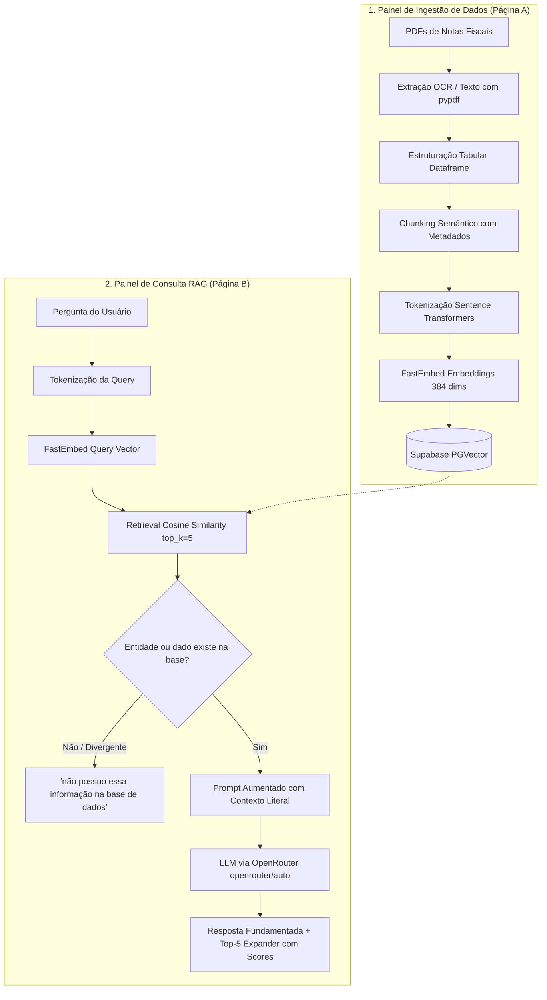

# 🎃 RAG Halloween Edition | Aplicação RAG Didática e Visual

<p align="center">
  
</p>

<p align="center">
  
  
  
  
  
  
</p>

---

## 📖 Visão Geral do Projeto
O **RAG Halloween Edition** é uma aplicação educacional desenvolvida para demonstrar de ponta a ponta o funcionamento de uma arquitetura **RAG (Retrieval-Augmented Generation)**. 

O sistema processa Notas Fiscais (DANFE) em PDF, extrai dados estruturados em formato tabular, divide os textos em chunks semânticos, gera representações vetoriais densas de 384 dimensões via **FastEmbed**, armazena e recupera os dados no banco vetorial remoto **Supabase (pgvector)** e responde via **OpenRouter** com uma **regra estrita antialucinação**.

---

## 🎨 Identidade Visual & Temática
- **Conceito:** RAG Halloween Edition (Gatinho travesso e fofinho de Halloween com machado cenográfico de Lizzie Borden).
- **Design:** Tema Dark Glow temático de Halloween (fundo roxo escuro `#120822`, destaque em laranja neon `#ff6e14` e tipografia de alto contraste para máxima legibilidade).

---

## 🏗️ Arquitetura do Sistema



---

## 📂 Estrutura de Diretórios

```
Rag/
├── assets/
│   └── rag_mascot.jpg          # Mascote visual do projeto RAG Halloween Edition
├── dados_notas_fiscais/              # Base de 4 PDFs de Notas Fiscais fictícias
│   ├── NF_001_Gatinhos_Petshop.pdf
│   ├── NF_002_Servicos_Tech_Rag.pdf
│   ├── NF_003_Loja_Fantasias_Halloween.pdf
│   └── NF_004_Equipamentos_Laboratorio.pdf
├── .env.example                      # Template seguro para as variáveis de ambiente
├── .gitignore                        # Proteção de credenciais, venv, caches e temporários
├── requirements.txt                  # Lista completa de dependências congeladas (UTF-8)
├── setup_supabase_pgvector.sql       # Script DDL (extensão vector, tabela, HNSW e RPC)
├── test_connection.py                # Teste isolado de sanidade (Supabase + OpenRouter)
├── init_supabase.py                  # Script de verificação da tabela no Supabase
├── generate_invoices.py              # Gerador dos PDFs fiscais fictícios
├── data_pipeline.py                  # Pipeline OCR, FastEmbed e busca vetorial
├── backend.py                        # Backend assíncrono em FastAPI
├── app.py                            # Frontend Streamlit (Página A: Ingestão / Página B: Chat)
└── README.md                         # Documentação completa
```

---

## 🚀 Instalação e Execução

### 1. Clonar o Repositório
```bash
git clone https://github.com/SEU_USUARIO/SEU_REPOSITORIO.git
cd Rag
```

### 2. Procedimento de Criação e Ativação do Ambiente Virtual (`venv`)

O uso de um ambiente virtual isola todas as dependências e evita conflitos com pacotes globais do sistema.

#### Passo 2.1 — Criar o ambiente virtual:
Abra o terminal na pasta raiz do projeto (`Rag`) e execute:

- **Windows:**
  ```powershell
  python -m venv venv
  ```
- **Linux / macOS:**
  ```bash
  python3 -m venv venv
  ```
*(Uma pasta chamada `venv/` será criada localmente contendo o interpretador Python isolado).*

#### Passo 2.2 — Ativar o ambiente virtual:
Conforme o seu sistema e terminal, execute o comando de ativação correspondente:

- **Windows (PowerShell):**
  ```powershell
  .\venv\Scripts\Activate.ps1
  ```
  > 💡 **Dica (Erro de Script no PowerShell):** Se o Windows exibir um erro de política de execução (`execution of scripts is disabled`), habilite a execução para o processo atual rodando:
  > ```powershell
  > Set-ExecutionPolicy -Scope Process -ExecutionPolicy Bypass
  > .\venv\Scripts\Activate.ps1
  > ```

- **Windows (Prompt de Comando - CMD):**
  ```cmd
  .\venv\Scripts\activate.bat
  ```

- **Linux / macOS (Bash ou Zsh):**
  ```bash
  source venv/bin/activate
  ```

#### Passo 2.3 — Confirmar a ativação:
Quando o ambiente estiver ativo, o prefixo `(venv)` aparecerá no início da linha de comando do seu terminal:
```text
(venv) PS C:\Users\...\Rag>
```

---

### 3. Instalação dos Pacotes do `requirements.txt`

Com o ambiente virtual devidamente ativo `(venv)`:

#### Passo 3.1 — Atualizar o gerenciador `pip` (Recomendado):
```bash
python -m pip install --upgrade pip
```

#### Passo 3.2 — Instalar todas as dependências do projeto:
```bash
pip install -r requirements.txt
```

#### Passo 3.3 — Conferir a instalação:
Para verificar se as principais bibliotecas foram instaladas com sucesso, você pode listar os pacotes principais:
```bash
python -c "import fastapi, streamlit, fastembed, supabase; print('Dependências instaladas com sucesso!')"
```

---

### 4. Configurar as Variáveis de Ambiente
Copie o arquivo `.env.example` para `.env`:
```bash
cp .env.example .env
```
Preencha o `.env` com suas chaves:
```env
SUPABASE_URL=https://seu-projeto.supabase.co
SUPABASE_SECRET_KEY=sb_secret_sua_chave_aqui
OPENROUTER_API_KEY=sk-or-v1-sua_chave_aqui
OPENROUTER_MODEL=openrouter/auto
```

### 5. Executar o Teste de Sanidade
Antes de iniciar a aplicação, valide a conectividade com as APIs:
```bash
python test_connection.py
```

### 6. Configurar o Supabase (PGVector)
1. Acesse o **SQL Editor** no painel do seu projeto Supabase.
2. Copie e execute o conteúdo do arquivo [setup_supabase_pgvector.sql](setup_supabase_pgvector.sql).
3. Verifique o status com:
   ```bash
   python init_supabase.py
   ```

### 7. Iniciar o Backend (FastAPI)
```bash
uvicorn backend:app --host 127.0.0.1 --port 8000 --reload
```
Acesse a documentação interativa: **[http://127.0.0.1:8000/docs](http://127.0.0.1:8000/docs)**

### 8. Iniciar o Frontend (Streamlit)
Em outro terminal com o `venv` ativo:
```bash
streamlit run app.py
```
Acesse a interface no navegador: **[http://localhost:8501](http://localhost:8501)**

### 9. Desativar o Ambiente Virtual (Ao Encerrar)
Quando terminar de utilizar ou testar o projeto, desative o ambiente virtual rodando:
```bash
deactivate
```

---

## 🛡️ Regra Antialucinação Estrita

O sistema possui diretivas estritas de integridade documental:
- Caso o usuário faça perguntas sobre produtos, pessoas ou termos que **não constem literalmente na base** (por exemplo: termos aproximados, apelidos ou entidades inexistentes), o modelo **não faz deduções ou suposições**.
- A resposta é padronizada rigorosamente como:
  > **`não possuo essa informação na base de dados`**

---

## 👥 Autoria e Licença
Desenvolvido para fins educacionais e didáticos no ecossistema de Inteligência Artificial e RAG.  
Distribuído sob a licença MIT.
